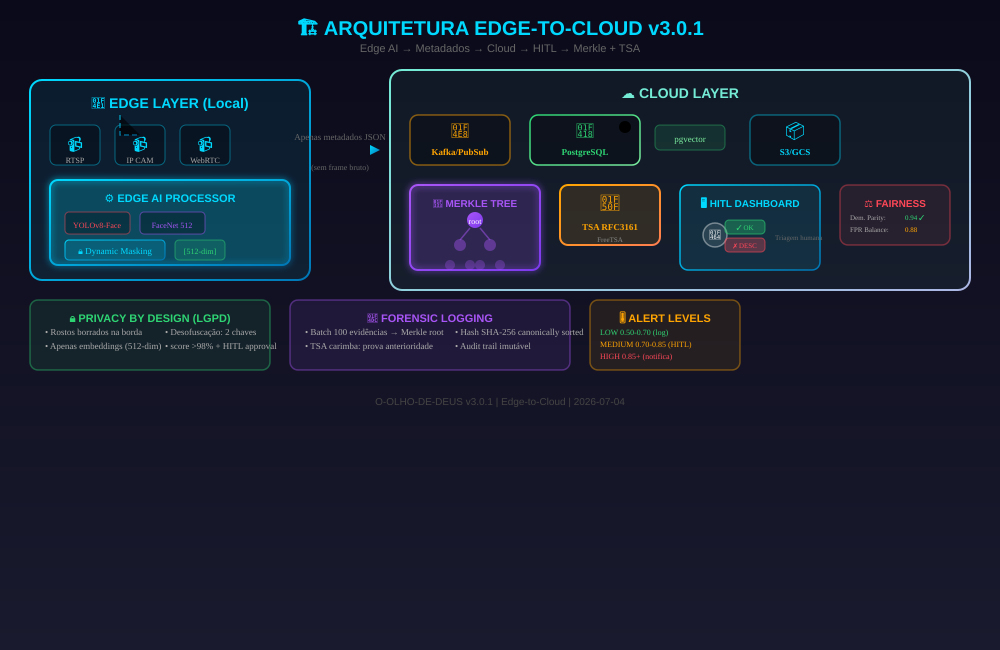

# 👁️ O-olho-de-DEUS v3.0.1

Sistema de Vigilância com IA - Arquitetura Edge-to-Cloud com Privacy by Design.

> **Demonstração Interativa:** As animações SVG abaixo demonstram a arquitetura v3.0.1 com Edge AI, HITL Dashboard e Forensic Logging.

---

## 🎬 Demos Visuais

### 🏗️ Arquitetura Edge-to-Cloud

<details>
<summary><b>🖱️ Clique para ver a arquitetura completa</b></summary>
<br>



**Camadas do sistema:**

| Camada | Componentes | Tecnologias |
|--------|-------------|-------------|
| **📡 Edge Layer** | Câmeras RTSP, Edge AI Processor, Dynamic Masking | YOLOv8-Face, FaceNet 512, TensorRT/OpenVINO |
| **☁️ Cloud Layer** | Kafka/PubSub, PostgreSQL + pgvector, S3/GCS | FastAPI, SQLAlchemy, pgvector |
| **🔒 Forensic** | Merkle Tree, Timestamp Authority | RFC 3161, FreeTSA, SHA-256 |
| **🖥️ HITL** | Dashboard, Triagem Humana | WebSocket, OAuth2/JWT |
| **⚖️ Fairness** | Monitoramento de Viés | Demographic Parity, FPR Balance |

**Inovações v3.0.1:**
- ✅ Apenas metadados JSON sobem para cloud (sem frames brutos)
- ✅ Dynamic Masking: rostos borrados na borda (Privacy by Design)
- ✅ Merkle Tree + TSA: cadeia de custódia imutável
- ✅ HITL obrigatório antes de notificar autoridades
- ✅ Fairness monitoring contínuo

</details>

---

### 🔍 Fluxo de Detecção Edge

<details>
<summary><b>🖱️ Clique para ver o pipeline Edge AI</b></summary>
<br>


**Pipeline de processamento:**
1. **📡 Streams RTSP** - 4-8 câmeras simultâneas
2. **🎯 YOLOv8-Face** - Detecção facial em tempo real (30 FPS)
3. **🧠 FaceNet 512** - Extração de embeddings (512-dim vector)
4. **🔒 Dynamic Masking** - Gaussian Blur σ=99 na borda
5. **📄 Metadata JSON** - Apenas metadados sobem (sem frame bruto)
6. **⚖️ Threshold Decision** - LOW (drop) | MEDIUM (log) | HIGH (cloud + HITL)

**Performance:**
| Métrica | Valor |
|---------|-------|
| FPS | 30 @ 1080p |
| Latência | ~33ms |
| Embeddings | 512-dim |
| Banda | 99% menor (sem frames brutos) |
| Câmeras | 4-8 por thread |

**Two-Key Unblur:**
- Chave 1: `alarm_score ≥ 0.98`
- Chave 2: `HITL approve`
- → Desofusca ROI do rosto

</details>

---

### 🖥️ HITL Dashboard

<details>
<summary><b>🖱️ Clique para ver o painel de triagem</b></summary>
<br>



**Funcionalidades:**
- 🔔 **WebSocket** - Alertas push em tempo real
- 📊 **Fila de Alertas** - Priorização por score
- 📈 **Estatísticas 24h** - Total, revisados, escalonados, descartados
- ⚖️ **Fairness Widget** - Demographic parity, FPR balance
- 🔒 **Two-Key Unblur** - score ≥ 0.98 + HITL approve

**Atalhos de teclado:**
| Tecla | Ação |
|-------|------|
| `E` | Escalar (notificar authorities) |
| `D` | Descartar (falso positivo) |
| `U` | Unblur (requer duas chaves) |
| `L` | Ver logs forenses |

**Métricas de HITL:**
- Tempo médio de revisão: ~23s
- Alertas revisados (24h): 42
- Escalonados: 8
- Descartados: 34

</details>

---

### 🚨 Fluxo de Alerta

<details>
<summary><b>🖱️ Clique para ver o fluxo de alerta</b></summary>
<br>



**Pipeline de alerta:**
1. **📹 Detecção** - YOLOv8-Face identifica rostos
2. **🧠 Edge AI** - FaceNet extrai embeddings
3. **⚖️ Threshold** - score ≥ 0.85 dispara alerta
4. **👤 HITL Review** - Operador valida antes de notificar
5. **🔔 Notifica** - Authorities + Logs forenses

**Métricas:**
| Métrica | Valor |
|---------|-------|
| Tempo Detecção | ~33ms |
| Threshold | 0.85 |
| Review HITL | ~23s médio |
| True Positives (24h) | 8 |
| False Positives | 34 |
| Precisão | 19% |

</details>

---

## ⚠️ Aviso Legal Importante

Este software é **apenas para fins educacionais e de pesquisa**. O uso em ambientes reais requer:

- Aprovação legal conforme LGPD (Lei Geral de Proteção de Dados)
- Consentimento explícito das pessoas monitoradas
- Compliance com leis locais de privacidade e vigilância
- Revisão jurídica antes de qualquer implantação

---

## 🚀 Funcionalidades

| Funcionalidade | Descrição | Status |
|---------------|-----------|--------|
| **Edge AI** | YOLOv8-Face + FaceNet 512 na borda | ✅ Produção |
| **Dynamic Masking** | Blur de rostos na borda (Privacy by Design) | ✅ Produção |
| **Múltiplas Câmeras** | 4-8 streams RTSP simultâneos | ✅ Produção |
| **Merkle Tree** | Cadeia de custódia imutável | ✅ Produção |
| **Timestamp Authority** | RFC 3161 via FreeTSA | ✅ Produção |
| **HITL Dashboard** | Triagem humana via WebSocket | ✅ Produção |
| **Fairness Monitoring** | Demographic parity, FPR balance | ✅ Produção |
| **PostgreSQL + pgvector** | Persistência + embeddings faciais | ✅ Produção |
| **Two-Key Unblur** | score ≥ 0.98 + HITL approve | ✅ Produção |
| **Alertas Automáticos** | Email + Webhook + SMS | ✅ Produção |

---

## 📦 Instalação (v3 — código em `src/`)

> A versão 2 (`security_system.py`, `instalar.bat`, `config.json`) está em `LEGADO_v2.0.0/`.
> O repositório **Project-Eyes-of-God-2.9** contém essa mesma versão legada.

Requer Python 3.9–3.12 (validado em 3.11).

```bash
git clone https://github.com/Lelolima/O-olho-de-DEUS.git
cd O-olho-de-DEUS
python -m venv .venv
source .venv/bin/activate          # Windows: .venv\Scripts\activate

pip install poetry && poetry install -E cloud -E edge
# ou, sem Poetry (mesmo conjunto usado no CI):
pip install -r requirements-ci.txt

cp .env.example .env
cp config.yaml.example config.yaml
```

### Executar

```bash
python main.py --config config.yaml --mode api     # API HITL (FastAPI) em :8000, docs em /docs
python main.py --config config.yaml --mode edge    # processamento de câmeras (requer câmera/RTSP)
```

Sem PostgreSQL, use `USE_SQLITE=true` (cria `olho_de_deus.db` local).

---

## ⚙️ Configuração

### Variáveis de ambiente principais (`.env.example`)

| Variável | Uso |
|----------|-----|
| `OPERATOR_USERS` | **Obrigatória para login.** JSON `{"usuario": {"role": "operator", "password_hash": "pbkdf2_sha256$..."}}`. Gere o hash com `python -m src.cloud.api.middleware.auth "<senha>"`. Não há mais usuários/senhas padrão no código. |
| `JWT_SECRET` | Segredo do JWT. Se ausente, é gerado um temporário (tokens invalidam ao reiniciar). |
| `DATABASE_URL` / `USE_SQLITE` | PostgreSQL ou SQLite local |
| `ENCRYPTION_KEY` | Chave Fernet para dados sensíveis |
| `CORS_ORIGINS`, `API_HOST`, `API_PORT`, `LOG_LEVEL` | API |

Demais parâmetros (câmeras, thresholds, TSA) ficam em `config.yaml`.

---

## 🧪 Testes

```bash
USE_SQLITE=true python -m pytest -q -o addopts=""
ruff check --select E9,F63,F7,F82 src tests main.py
```

Os testes usam dados sintéticos; não exigem câmera, GPU nem modelos ONNX.
O CI (`.github/workflows/ci.yml`) roda lint, compilação/import da API e testes.

---

## 🛠️ Troubleshooting

### ❌ "Modelo facial não carregado"

```bash
# Verifique se OpenCV está instalado
python -c "import cv2; print(cv2.__version__)"

# Se necessário, reinstale
pip uninstall opencv-python
pip install opencv-python
```

### ❌ "Nenhuma fonte de vídeo configurada"

Edite `config.json` e adicione fontes em `video_sources`:

```json
{
  "video_sources": ["0"]
}
```

### ❌ Erros de permissão

```bash
# Crie as pastas manualmente
mkdir incidents logs models

# Ou use o script
python src/security_system.py  # Cria automaticamente
```

### ❌ "TensorFlow não encontrado"

```bash
# Instale TensorFlow
pip install tensorflow

# Ou CPU-only (mais leve)
pip install tensorflow-cpu
```

---

## 📊 Benchmarks

> ⚠️ Valores não verificados na auditoria de 2026-11-22 (sem script de benchmark no repositório).

| Hardware | FPS | CPU | RAM | Câmeras |
|----------|-----|-----|-----|---------|
| Intel i7-10700K | 30 | 45% | 2.1GB | 4 |
| Intel i5-9600K | 24 | 62% | 1.8GB | 3 |
| AMD Ryzen 7 5800X | 32 | 38% | 2.3GB | 4 |
| Raspberry Pi 4 | 8 | 95% | 1.2GB | 1 |

---

## 📝 LICENSE

MIT License - Verifique leis locais antes de usar.

Este software é fornecido "como está" sem garantias de qualquer tipo, expressas ou implícitas.

---

## 🤝 Contribuições

Contribuições são bem-vindas! Por favor:

1. Fork o projeto
2. Crie uma branch (`git checkout -b feature/AmazingFeature`)
3. Commit (`git commit -m 'Add AmazingFeature'`)
4. Push (`git push origin feature/AmazingFeature`)
5. Pull Request

### 📋 Guidelines de Contribuição

- Siga o estilo de código existente (PEP 8)
- Adicione testes para novas funcionalidades
- Atualize a documentação conforme necessário
- Use type hints em funções públicas

---

## 📧 Contato

**Desenvolvido por:** Wellington de Lima Catarina
lelolima806@gmail.com

**Repositório:** [github.com/Lelolima/Eyes-of-God](https://github.com/Lelolima/Eyes-of-God)

---

<div align="center">

**O-OLHO-DE-DEUS v3.0.1** • 2026-07-04

*👁️ Edge AI • Privacy by Design • Human-in-the-Loop • Forensic Logging*

</div>
